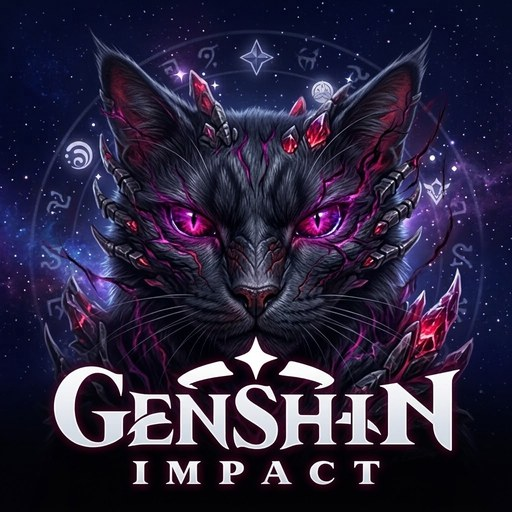

  

# Genshin Build Card

Wpisujesz UID, dostajesz profil gracza z Genshin Impact: awatar, wizytówki, poziomy, Otchłań i postacie z gabloty. Po kliknięciu postaci widać jej statystyki, broń i artefakty. Ten sam kod działa jako strona i jako zwykły program na Windowsa.

Wersja online: https://gumakulka.github.io/genshin-build-card/ – gracza można podać od razu w adresie, np. `?uid=760720445`.

## Co potrafi

Poza samym podglądem profilu są też: suma CV i RV artefaktów (substaty do RV wybierasz sam), paski postępu dla szansy i obrażeń kryt. oraz regeneracji energii względem własnych celów, porównanie dwóch graczy, link do wyniku, lista ostatnich UID i zapis karty postaci do PNG. Strona ma jasny i ciemny motyw oraz polską i angielską wersję.

## Jak to jest zrobione

Frontend to zwykły HTML, CSS i JavaScript, bez bibliotek i bez budowania. Enka.Network nie wysyła nagłówków CORS, więc przeglądarka nie może pytać jej bezpośrednio. Pośredniczą w tym mały Worker na Cloudflare (`worker/index.js`): przyjmuje tylko adresy w formacie `/uid/123456789` i odpowiada wyłącznie stronom z listy `ALLOWED_ORIGINS`.

Nazwy postaci, broni i zestawów oraz ikony biorę z danych Enki. Pliki z nazwami są przypięte do jednego commita ich repozytorium, więc nowe postacie pojawią się dopiero po zmianie numeru w `STORE_URL` (`app.js`).

## Uruchomienie lokalnie

Otwórz folder w VS Code i włącz `index.html` przez Live Server. Port 5500 jest dopuszczony w Workerze. Zwykłe otwarcie pliku z dysku nie zadziała, bo Worker odrzuca zapytania z nieznanych adresów.

## Własny Worker

Wklej `worker/index.js` do nowego Workera w Cloudflare i zmień `ALLOWED_ORIGINS` na adresy swojej strony. Adres Workera wpisz w `WORKER_URL` (`app.js`) oraz w polityce CSP w `index.html`.

## Wersja na Windowsa

Folder `desktop/` to opakowanie w Electronie. Plik `.exe` buduje GitHub Actions: zakładka Actions, workflow „Build Windows exe”, Run workflow, a gotowy plik jest w artefaktach uruchomienia. Szczegóły są w `desktop/README.md`. Program nie jest podpisany, więc SmartScreen może ostrzegać.

## Znane ograniczenia

- Szczegóły postaci są tylko wtedy, gdy gracz ma publiczną gablotę w grze.
- Maksymalne rzuty do RV wpisałem ręcznie (`MAX_ROLLS` w `app.js`), więc wynik może się trochę różnić od innych kalkulatorów.
- Etykiety „Stygian” i „Maks. przyjaźń” to moja interpretacja pól, których dokumentacja Enki nie opisuje.
- Talenty pokazują poziomy bazowe, bez bonusów z konstelacji.

## Licencja

MIT. To projekt fanowski, bez związku z HoYoverse; grafiki z gry należą do ich właścicieli i są ładowane z Enka.Network dopiero w trakcie działania strony. Na logo w `build/` jest znak gry, który też jest własnością HoYoverse.
