  

  <a href="#polski"><b>Polski</b></a> &nbsp;·&nbsp; <a href="#english"><b>English</b></a>

  

  
  
  

  

  

## Polski

Wpisz UID gracza z Genshin Impact, a Genshin Build Card pokaże jego profil oraz postacie z gabloty: statystyki, talenty, broń i artefakty. Wszystko działa w przeglądarce, bez logowania i bez instalacji.

**Strona:** https://gumakulka.github.io/genshin-build-card/

### Jak korzystać z Genshin Build Card

1. Wpisz 9-cyfrowy UID gracza.
2. Kliknij „Szukaj”.
3. Wybierz postać z listy, a zobaczysz jej kartę.

Do strony możesz też wejść od razu z konkretnym graczem, na przykład `?uid=760720445` dopisanym do adresu.

### Co potrafi Genshin Build Card

- **Karta postaci** w stylu gabloty: duża grafika, poziom, konstelacje, talenty, broń, statystyki i pięć artefaktów z podstatystykami.
- **Kolory według żywiołu.** Po otwarciu postaci zmienia się kolor całej strony, światła w tle i kształt iskier.
- **Ocena artefaktów:** RV i Crit Value, znaczniki najlepszego i najsłabszego artefaktu oraz szacunek liczby ulepszeń przy każdej podstatystyce.
- **Opisy po dotknięciu.** Kliknij konstelację albo talent, a pod kartą zobaczysz opis i wartości przy Twoim poziomie.
- **Księga postaci:** talenty z realnymi mnożnikami, konstelacje oraz materiały, których jeszcze brakuje.
- **Porównywanie dwóch graczy** i zapis karty postaci jako obraz PNG.
- **Mapa i plan farmienia.**
- **Ulubieni gracze, historia konta i tryb offline.** Dane zostają w Twojej przeglądarce, a aplikacja pamięta tylko dziesięciu ostatnich graczy.
- **Wersja polska i angielska** oraz jasny i ciemny motyw.

### Na telefonie

Na wąskim ekranie na dole pojawia się pasek z czterema skrótami: Szukaj, Postać, Narzędzia i Mapa. Postacie przełączasz przesunięciem palca, a przycisk „Widok skrócony” chowa dłuższe statystyki.

### Czego Genshin Build Card nie potrafi

- Szczegóły postaci widzisz tylko wtedy, gdy gracz ma publiczną gablotę w grze.
- Lista znajomych z gry jest niepubliczna, więc nie da się jej pokazać.
- Dane z gabloty odświeżają się z opóźnieniem po zmianach w grze.

### Wersja na Windowsa

Aplikację na Windowsa buduje GitHub Actions. Instrukcja dla programistów jest w [desktop/README.md](desktop/README.md).

  

## English

Enter a Genshin Impact player's UID and Genshin Build Card shows their profile and showcased characters: stats, talents, weapon and artifacts. It runs in the browser, with no login and nothing to install.

**Site:** https://gumakulka.github.io/genshin-build-card/

### How to use Genshin Build Card

1. Enter the player's 9-digit UID.
2. Press "Search".
3. Pick a character from the list to open their card.

You can also open the site straight on a player by adding, for example, `?uid=760720445` to the address.

### What Genshin Build Card can do

- **Showcase-style character card:** large artwork, level, constellations, talents, weapon, stats and five artifacts with their substats.
- **Colors by element.** Opening a character recolors the whole page, the background lights and the shape of the sparks.
- **Artifact scoring:** RV and Crit Value, markers for the best and weakest artifact, and an estimate of how many upgrades each substat has.
- **Tap for details.** Select a constellation or a talent to see its description and the values at your level below the card.
- **Character codex:** talents with real multipliers, constellations and the materials you still need.
- **Two-player comparison** and saving a character card as a PNG image.
- **Map and farming plan.**
- **Favorite players, account history and offline mode.** Data stays in your browser, and the app remembers only the ten most recent players.
- **Polish and English** interface with light and dark themes.

### On a phone

On a narrow screen a bar with four shortcuts appears at the bottom: Search, Character, Tools and Map. Swipe to switch characters, and the "Compact view" button hides the longer stat lists.

### What Genshin Build Card cannot do

- Character details appear only if the player has a public showcase in the game.
- The in-game friends list is not public, so it cannot be shown.
- Showcase data refreshes with a delay after changes in the game.

### Windows version

The Windows app is built by GitHub Actions. Developer instructions are in [desktop/README.md](desktop/README.md).

  

## Podziękowania i prawa · Credits and rights

- [Enka.Network](https://enka.network/): dane z gabloty graczy i grafiki postaci · showcase data and character artwork.
- [Project Amber](https://gi.yatta.moe/): opisy, talenty, materiały i grafiki · descriptions, talents, materials and art.
- [Fontsource](https://fontsource.org/) (Cinzel, Nunito) i [Lucide](https://lucide.dev/): czcionki i ikony · fonts and icons.

Kod jest na licencji MIT, a prawa do logo należą do autora. Genshin Impact, jego postacie i grafiki należą do HoYoverse. To projekt fanowski, niepowiązany z HoYoverse. · The code is MIT licensed and the logo belongs to its author. Genshin Impact, its characters and artwork belong to HoYoverse. This is a fan project, not affiliated with HoYoverse.

Autor · Author: Gumakulka

